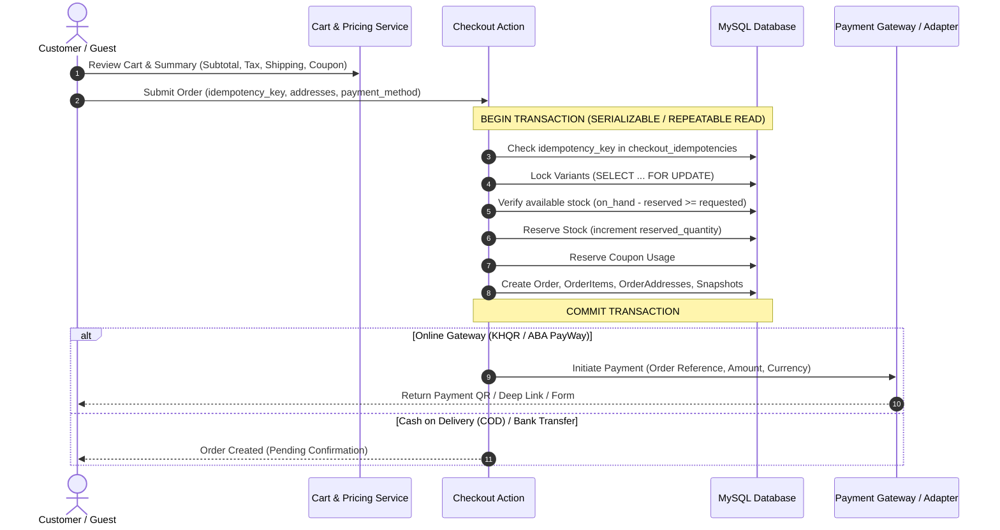
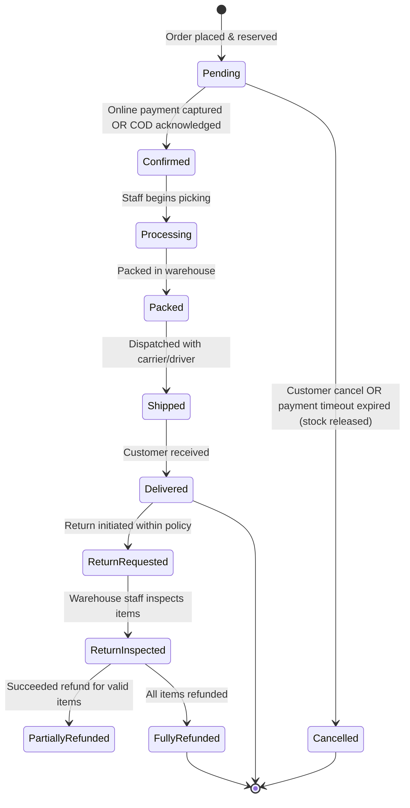
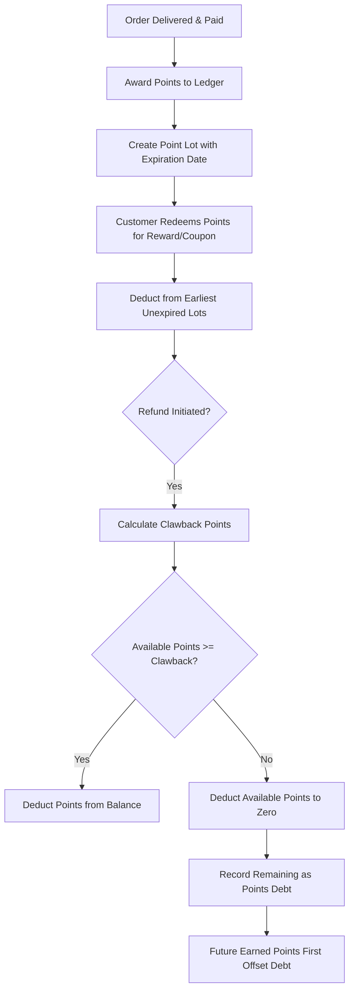
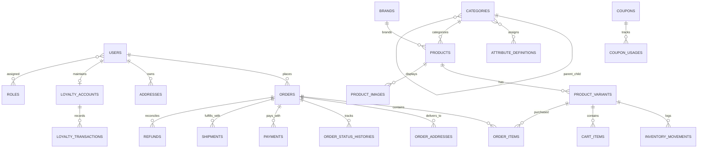

# D STORE - System Architecture & Module Boundaries

## 1. Domain & Module Boundaries

D STORE is architected as a modular monolith in Laravel 11 with distinct service domains:

```
app/
├── Models/                     # Eloquent entities with explicit casts & relationships
├── Http/
│   ├── Controllers/
│   │   ├── Customer/           # Customer-facing Inertia controllers
│   │   └── Admin/              # Protected administrative controllers
│   ├── Requests/               # Form validation requests with strict rules
│   └── Middleware/             # Localization, active staff, role-based checks
├── Services/
│   ├── Identity/               # Authentication, staff RBAC, session management
│   ├── Catalog/                # Category hierarchy, dynamic attributes, variants, media
│   ├── Inventory/              # Append-only movements, atomic reservations, safety thresholds
│   ├── Cart/                   # Guest & user cart lifecycle, item normalization, merge
│   ├── Pricing/                # Minor-unit calculation pipeline, campaign rules, tax, currency
│   ├── Checkout/               # Idempotent order placement, atomic stock & coupon locking
│   ├── Order/                  # State machine transitions, history, invoices
│   ├── Payment/                # Gateway contracts, sandbox adapters, webhook deduplication
│   ├── Refund/                 # Partial/full allocations, return inspection, restock
│   ├── Shipping/               # Geographic zones (Cambodia provinces/districts), rates
│   ├── Loyalty/                # Signed ledger, point lots/expiry, clawback debt accounting
│   ├── Marketing/              # Coupon validation, hero banners, flash sales, campaigns
│   ├── Content/                # CMS pages (About, FAQ, Terms), contact messages, newsletter
│   └── Reporting/              # Financial aggregation, paid sales vs net revenue, charts
```

---

## 2. Key Transactional Flows

### Flow A: Checkout & Inventory Reservation


### Flow B: Order Fulfillment & Payment Reconciliation


### Flow C: Loyalty Ledger & Clawback Debt


---

## 3. Entity-Relationship Model (Core Entities)



---

## 4. Deployment Topology

- **Web / App Container**: PHP 8.3-FPM + Nginx, running Laravel 11.
- **Frontend Assets**: Precompiled static assets via Vite, served directly by Nginx with gzip/brotli compression.
- **Database**: MySQL 8.0+ with InnoDB storage engine, `utf8mb4_unicode_ci`, strict SQL mode.
- **Queue / Scheduler**: Laravel worker queue process handling background notifications, payment timeout checks, and point lot expiry.
- **Mail Capture (Dev)**: Mailpit running on port 1025 (SMTP) and 8025 (Web UI).
